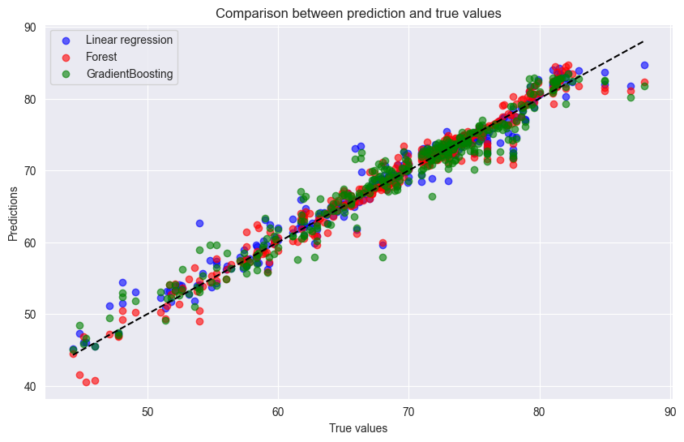

# WHO life expectancy prediction

I tried to predict a country's life expectancy in a given year from the health and economic indicators in the WHO life expectancy dataset. I started with a deep neural network in TensorFlow/Keras, which did not train well, and then switched to scikit-learn's linear regression, random forest and gradient boosting models, which did much better.



## How it works

1. Load `Life Expectancy Data.csv` (2,938 rows, 22 columns, one row per country per year).
2. Drop every row with a missing value, which leaves 1,649 rows, and shuffle.
3. Use `Life expectancy` as the target and the other 21 columns as features. `Country` and `Status` are one-hot encoded with the first category dropped, giving 152 feature columns.
4. Split 80/20 into training and test sets with `train_test_split`.
5. Train a Keras `Sequential` network: a 154-unit dense layer, a `Normalization` layer, three dense layers of 10,000 units, then 1,000, 100 and 10 units (all ReLU) and one output. Loss is mean absolute error (MAE) with the Adam optimiser.
6. Train `LinearRegression`, `RandomForestRegressor` and `GradientBoostingRegressor` from scikit-learn with default settings on the same split, and report MSE, MAE and R² on the test set.

## Results

All figures are on the 20% test split, from the saved notebook outputs. MAE is in years.

| Model | MAE | MSE | R² |
|---|---|---|---|
| Deep neural network | 6.96 | not measured | not measured |
| Random forest | 1.07 | 2.90 | 0.963 |
| Linear regression | 1.10 | 2.77 | 0.964 |
| Gradient boosting | 1.41 | 4.05 | 0.948 |

The neural network never got going. The first epoch had a training loss of about 1.4 million, after which the loss sat at about 69 for every epoch shown, which is roughly what you get by predicting zero for everyone. Each epoch took two to four minutes on my machine, so I stopped it partway through the fourth epoch. The test set evaluation saved in the notebook gives an MAE of 6.96 years, but it comes from a later run whose training output was not saved. Looking back, the input features were never scaled (population and GDP are in the millions) and the `Normalization` layer was never adapted to the data, which probably explains a lot of this.

The three scikit-learn models were all close, with errors of about a year. Plain linear regression did almost as well as the random forest.

In the notebook the first evaluation output is headed "Linear Regression" even though it was called on the random forest predictions (`y_pred_1`). The plot legend has the same mix-up: the blue points labelled "Linear regression" are the random forest and the red points labelled "Forest" are linear regression.

## Repository layout

| Path | What it is |
|---|---|
| `Life_expectancy.ipynb` | Data preparation, the neural network and the scikit-learn models |
| `Life Expectancy Data.csv` | The WHO life expectancy dataset the notebook reads |
| `output.png` | Predicted against true values for the three scikit-learn models |

## Running it

The notebook needs pandas, NumPy, scikit-learn, TensorFlow, Matplotlib and seaborn. There is no requirements file.

```
pip install pandas numpy scikit-learn tensorflow matplotlib seaborn
jupyter notebook Life_expectancy.ipynb
```

Run it from the repository folder so it can find the CSV. The neural network cell is set to 2,500 epochs and is very slow on a CPU, so you may want to lower that or skip the cell.

## Limitations

No random seed is set for the shuffle or the split, so numbers will change slightly on each run. Because `Country` is a feature and rows are split at random, the same country appears in both the training and test sets for different years, which makes the test easier than predicting for an unseen country. An `EarlyStopping` callback is defined but never passed to `fit`.
